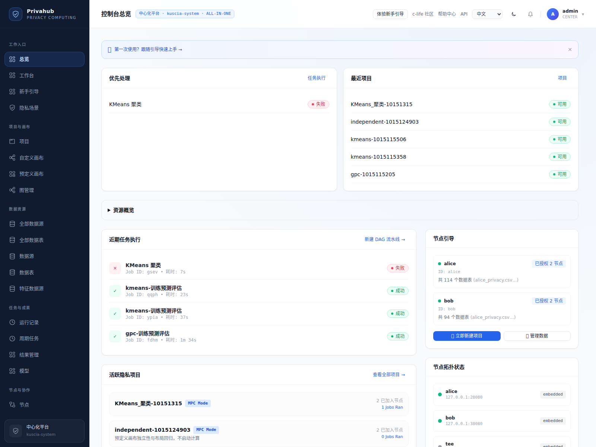
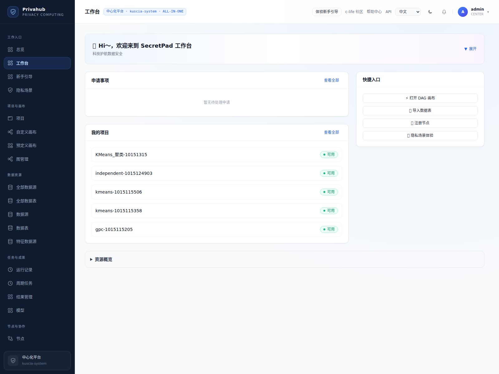
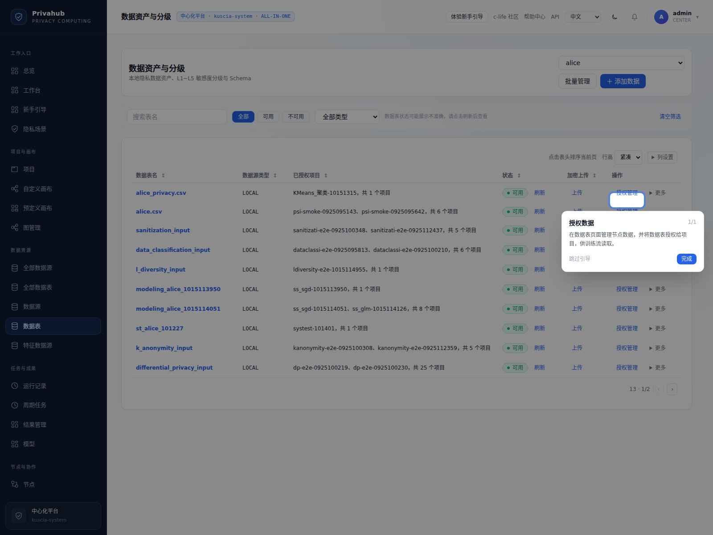
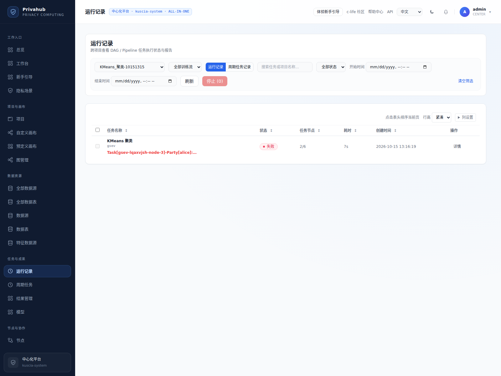
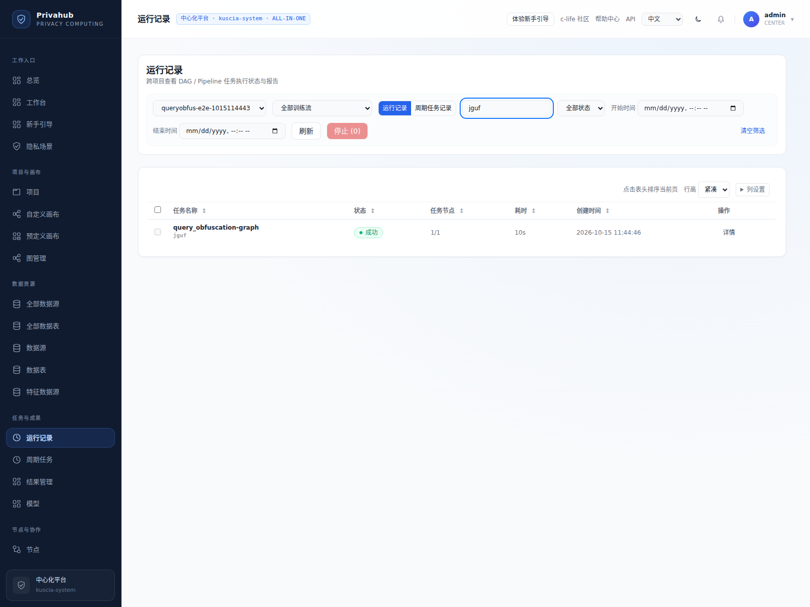
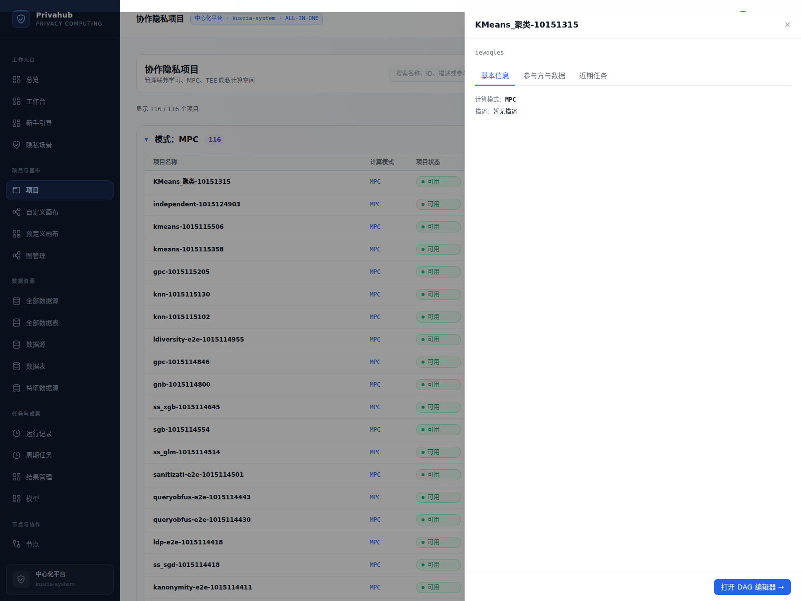
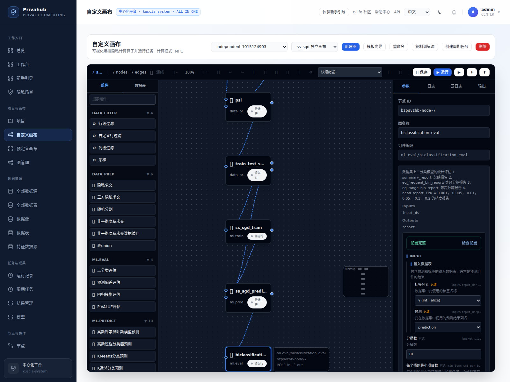
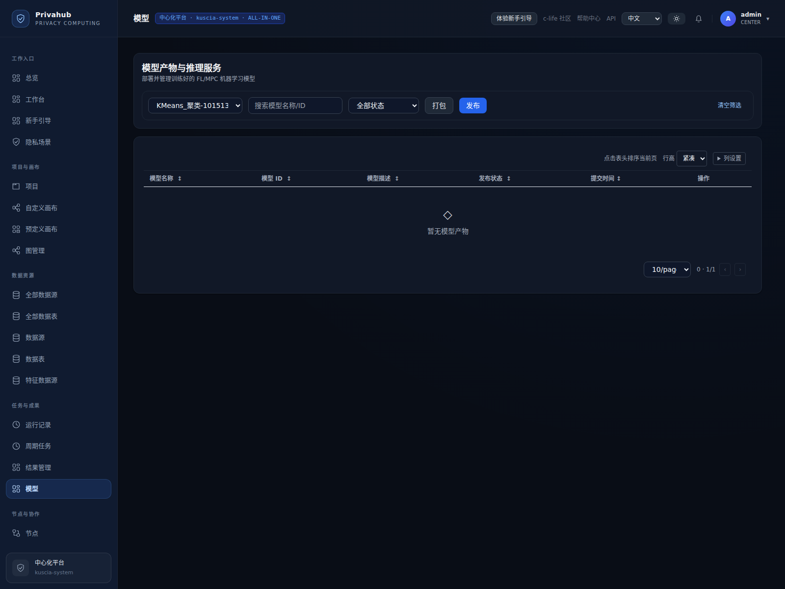
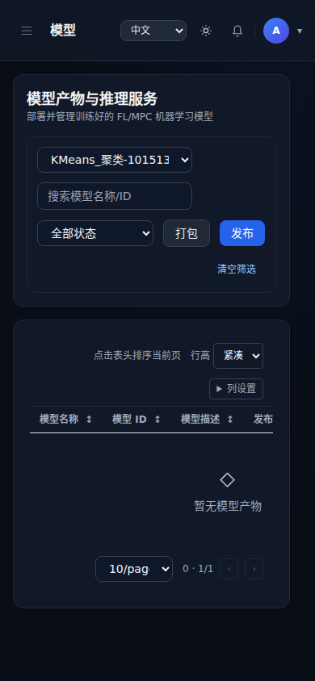

# 页面信息展示优化

## 已完成

| 区域 | 调整 |
| --- | --- |
| 主页导航 | 工作入口、项目与画布、数据资源、任务与成果、节点与协作、平台管理；按角色保留可访问入口，工作台机构参数不影响高亮 |
| 项目 | 分组折叠，多字段搜索；紧凑列表、分页卡片、全部卡片三种视图并记忆选择 |
| 数据表、模型、结果、运行记录 | 共用 TableView：紧凑 / 舒适行高、列显隐、列宽设置、固定表头、当前页排序与恢复默认，显示偏好保存在当前浏览器 |
| 筛选工具栏 | 共用 FilterBar，窄屏自动换行，支持清空筛选；清空时保留项目或节点范围 |
| 运行记录 | 普通任务与周期任务均在后端先执行关键词、状态、时间筛选，再统计和分页，支持名称、任务 ID、所属画布名称搜索 |
| 状态标签 | 共用状态映射和颜色，兼容 SUCCEED / SUCCEEDED / SUCCESS；未知服务器状态保留原文，避免误标成功 |
| 行操作 | 主要操作直接展示，其余收入“更多”，保留原权限、禁用原因和危险操作确认；支持 Escape / 点击外部关闭 |
| 总览 | 优先展示近期异常 / 运行任务、最近项目；统计指标折叠保留，近期项目限制展示数量；失败任务显示失败图标 |
| 工作台 | 待处理申请与最近项目优先，资源统计折叠，快捷入口按实际路由权限展示 |
| 详情 | 项目、模型和结果统一使用抽屉；项目按基本信息 / 参与方与数据 / 近期任务分标签，模型按信息 / 参与方 / 血缘 / 服务分标签，结果按内容 / 信息 / 血缘分标签 |
| DAG | 保留组件搜索与分组，搜索自动展开命中的折叠组；配置面板展示待完善数量，支持展开校验摘要并定位字段，校验不修改参数 |
| 空状态 | 区分加载、查询失败、真正无结果；统一加载骨架和空结果反馈，部分查询失败提供原范围重试 |
| 全局视觉 | 表格、筛选区、字号和行距统一；暗色下提高次要文字对比度；窄屏表格内部滚动，页面不横向溢出 |

## 使用方式

表格右上方“行高”切换紧凑或舒适模式，“列设置”可开关列并调整列宽。点击可排序表头按当前页数据排序；原来已有的服务端时间排序继续生效。恢复默认会清除当前表格的显示调整。

运行记录支持按关键词、状态和起止时间组合筛选。输入关键词后自动提交，切换筛选回到第一页并清空旧的批量选择；结束时间早于开始时间时会提示并暂停查询。筛选在 SQL COUNT / LIMIT 前执行，返回的总数与分页保持一致。查询值使用绑定参数，搜索通配符按普通字符处理；后端校验时间、状态和关键词长度。

## 范围和边界

- 表头通用排序只作用于已加载的一页，界面明确标注；运行记录关键词、状态、时间筛选和原有模型 / 结果服务端筛选则覆盖其查询范围的全部分页。
- 总览异常提示基于原有最近任务数据，不宣称全平台未处理任务总数；可从运行记录继续查询。
- 显示偏好只包含列宽、可见列和行高，不保存业务数据、身份凭证或授权信息。
- 未新增项目业务分类字段，不通过名称推断业务类型。列表模式与全部卡片仍一次展示全部匹配项目；超大集合的后端分页属于独立协议调整。
- 本轮没有重新执行计算算法；沿用此前 8 个建模和 12 个隐私算法的真实执行证据，对改动的显示、查询和配置路径进行系统回归。

## 验证与脚本

启动开发服务后运行：

```bash
node scripts/lib/verify-visual-system.mjs
python3 scripts/check-visual-system.py
```

浏览器脚本复用已有项目和任务，验证六个主要页面及其手机布局、列设置与恢复、实时后端任务搜索、错误时间区间、项目详情标签及 Escape、DAG、真实主题切换和手机布局。截图校验清单位于 `images/visual-system/manifest.json`。脚本不启动计算任务或删除数据。

前端回归覆盖排序、显示偏好恢复、损坏偏好回退、状态回退、折叠操作和配置校验；后端测试覆盖超过一页的任务搜索、分页总数、项目边界、时间边界、通配符 / 注入字符串、非法筛选和周期任务。

## 截图


















