# 发布说明草稿：控制台窄屏（手机）适配

- 日期：2026-10-21
- 提交：`30eb838` `feat(console): 适配手机窄屏布局与交互`
- 范围：`apps/secretpad`、`packages/design-system`、`packages/dag-next`
- 目标视口：320px – 768px；桌面端（≥ 1024px）保持原有布局

## 概述

本次发布让控制台在手机等窄屏设备上可正常浏览与操作：顶栏不再挤占标题空间，表格支持横向滚动，页面工具栏与弹窗内容按视口堆叠，DAG 编辑器在窄屏以浮层方式提供组件库与属性面板。桌面端布局、默认项目列表视图和既有交互不变。

## 主要变更

### 全局外壳与顶栏

- 顶栏高度在窄屏由 76px 压缩为 56px，标题始终可见并省略溢出。
- `< 640px` 时语言选择与主题切换收进头像下拉菜单；桌面端保留原顶栏控件。
- 新增 i18n 文案 `header.toggleTheme`（切换主题 / Toggle Theme）。

### 表格与页面工具栏

- graphs、periodic-tasks（列表/详情）、消息详情、数据表详情与授权配置等原生表格增加横向滚动容器。
- 节点、合作节点、图管理、项目列表的「选择器 + 搜索 + 按钮」在窄屏换行或纵向堆叠，输入框不再溢出卡片。

### 项目列表默认视图

- 无本地偏好时：`< 1024px` 默认卡片视图，桌面默认列表视图。
- 已保存的 `list` / `cards` / `all` 偏好始终优先。
- 列表视图的 `min-w-[980px]` 与内部横向滚动保持不变。

### DAG 编辑器（窄屏浮层化）

- 工具栏取消固定高度，右侧操作组支持横向滚动，节点/连线统计在手机上隐藏。
- 组件库在 `< 1024px` 变为左侧浮层（含关闭按钮与半透明遮罩），选择组件后自动收起。
- 属性面板在 `< 1024px` 变为右侧浮层（含关闭按钮与遮罩）。
- 画布容器窄屏最小高度由 560px 调整为 420px。
- 不新增触控缩放/拖拽手势，手机仍以查看、点选和工具栏操作为主。

### 设计系统

- `Modal` / `Drawer`：内边距随视口收紧，标题截断，底部按钮支持换行。
- `Tabs`：容器横向滚动，标签不换行。
- `Toast`：窄屏下左右留边，不再溢出视口。
- `Tour`：卡片宽度限制在视口内，高亮框按视口裁剪，超高/超宽目标不再把遮罩推出屏幕。

### 弹窗与登录页

- datasource 表单、数据上传、模型发布弹窗的栅格在窄屏改为单列。
- 修复登录页卡片被 `bg-surface-card` 覆盖为白底、白色标题不可见的问题。

## 行为变化

| 场景 | 变更前 | 变更后 |
|---|---|---|
| `< 640px` 语言/主题 | 顶栏右侧固定控件 | 头像菜单内切换 |
| 项目列表首次访问（`< 1024px`） | 默认列表（980px 宽表格） | 默认卡片视图 |
| DAG 组件库/属性面板（`< 1024px`） | 固定列，挤压画布 | 浮层 + 遮罩 |

## 验证结果

| 验证项 | 命令 | 结果 |
|---|---|---|
| 类型检查 | `corepack pnpm typecheck` | 通过 |
| Lint | `corepack pnpm lint` | 通过 |
| 单元测试 | `corepack pnpm test` | 通过：69 个文件 / 483 个用例 |
| 完整构建 | `corepack pnpm run build` | 通过：780 个模块，`dist` 1.7 MB / 67 个资源 |
| 定向 E2E | 登录流程 4 项 + CENTER 全页面渲染 | 5/5 通过 |
| 窄屏巡检 320/375 | Playwright | 全部断言通过 |
| 桌面回归 1440 | Playwright + 截图 | 布局与默认列表视图未变化 |

窄屏巡检断言：

- `document.documentElement.scrollWidth <= window.innerWidth`（表格内部滚动容器除外）。
- 顶栏 `h1` 宽度 > 0，标题可见。
- 项目页在 320/375 默认渲染卡片视图，1440 默认列表。
- DAG 画布宽度 > 280px，组件库浮层完全位于视口内。
- 头像菜单包含语言与主题入口。
- 登录卡片背景为深色（`rgba(17, 24, 39, 0.9)`），标题可见。

构建产物：

- `apps/secretpad/dist/index.html`（1.00 kB）
- `apps/secretpad/dist/assets/index-CD1rE8ZX.css`（68.67 kB / gzip 12.27 kB）
- `apps/secretpad/dist/assets/framework-BB3hKeIk.js`（446.65 kB / gzip 144.33 kB）
- 资源文件共 67 个，`dist` 总计 1.7 MB

## 截图

### 375px

| 页面 | 截图 |
|---|---|
| 登录 | 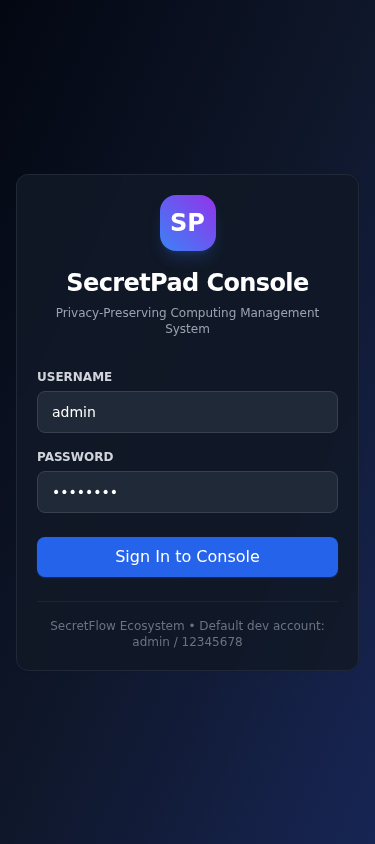 |
| 仪表盘 | 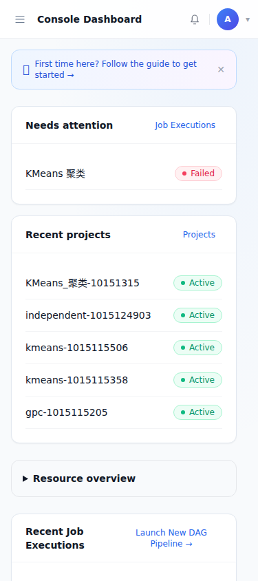 |
| 项目（默认卡片） | 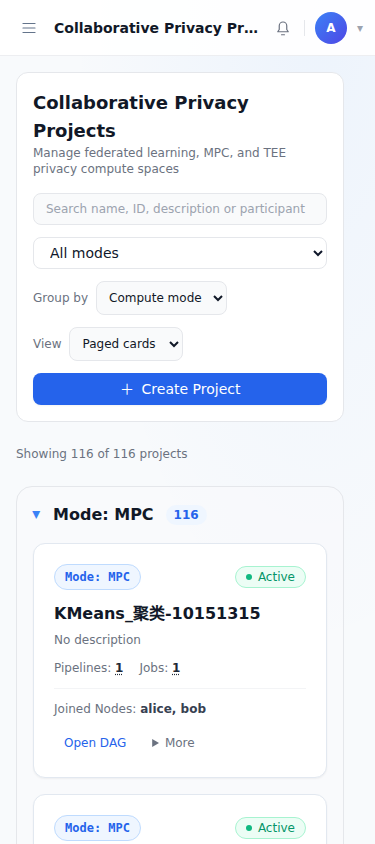 |
| 节点 | 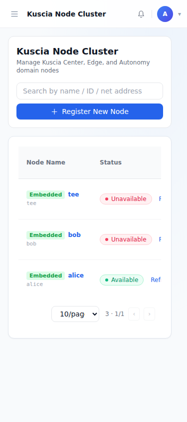 |
| 图管理 | 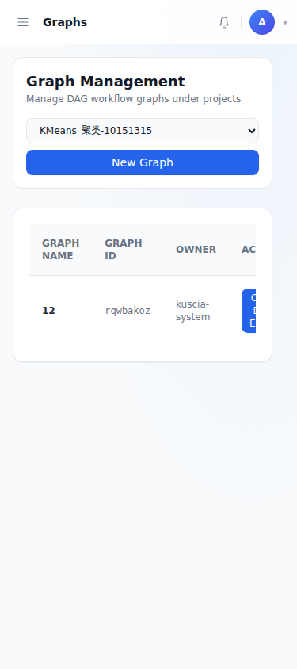 |
| 节点路由 | 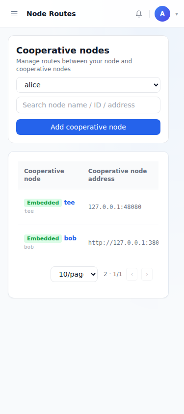 |
| 周期任务 | 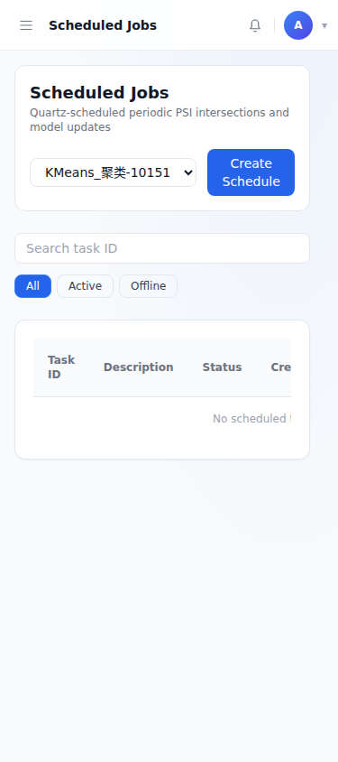 |
| 消息 | 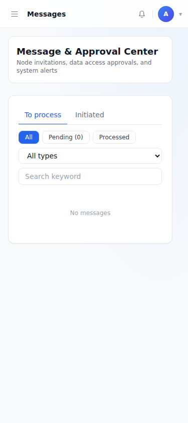 |
| 数据表 | 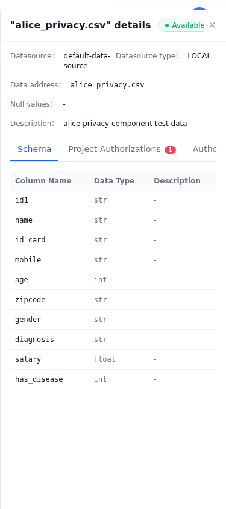 |
| DAG | 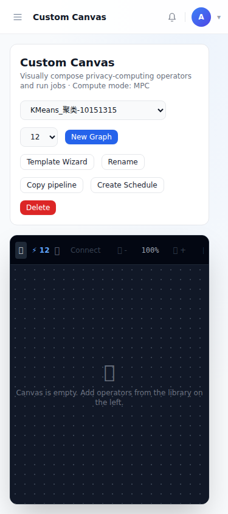 |
| DAG 组件库浮层 | 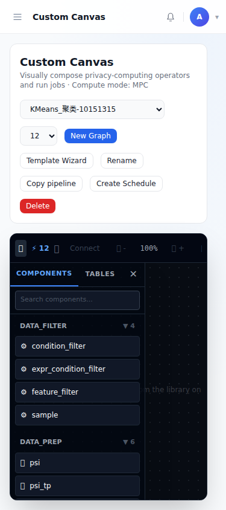 |

### 320px

| 页面 | 截图 |
|---|---|
| 登录 |  |
| 顶栏头像菜单（语言/主题） | 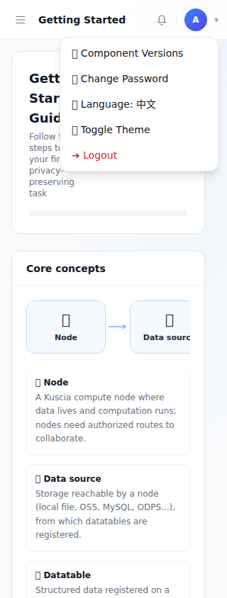 |
| DAG 组件库浮层 | 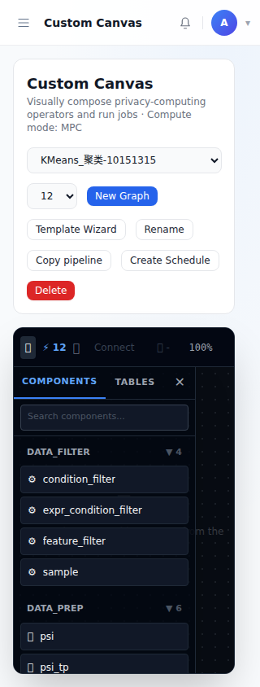 |

320px 下其余页面（dashboard、projects、nodes、graphs、node-routes、periodic-tasks、messages、data-tables、dag）的截图同样归档在 `assets/2026-10-21-narrow-screen/`。

### 1440px 回归

| 页面 | 截图 |
|---|---|
| 项目（默认列表） | 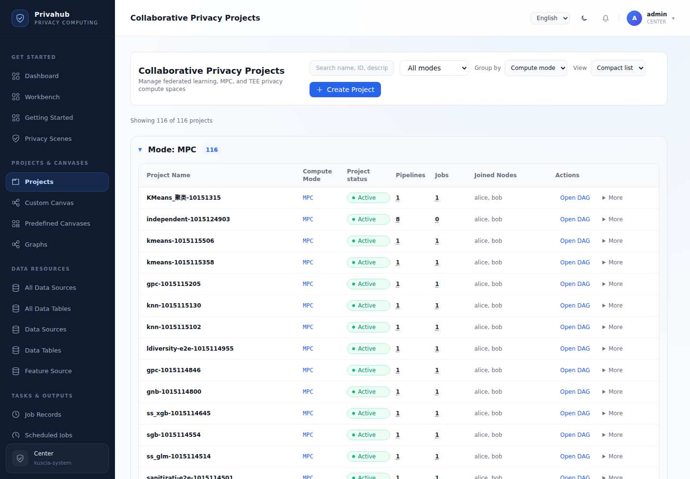 |
| DAG | 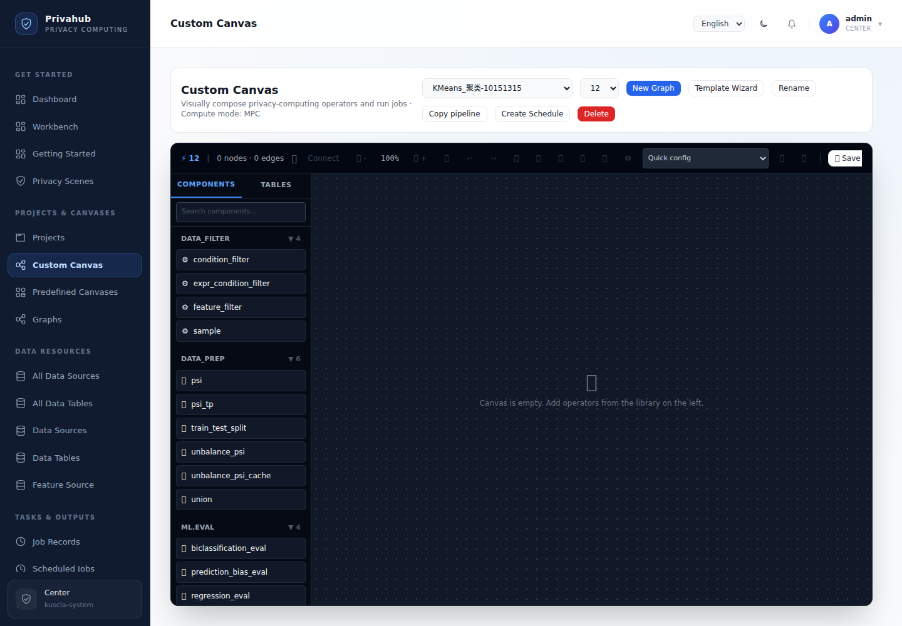 |

## 已知问题（与本次变更无关）

- `e2e/migration-system.spec.ts:43`：用例期望列表视图存在 "Clinical research collaboration" 标题，当前列表视图以按钮渲染项目名，标题仅存在于卡片视图。
- `e2e/migration-system.spec.ts:96`：用例期望 `[data-tour="project-list"] > div`，实际组件渲染 `<section>`。
- `privacy-scenes` 页面显示原始 i18n key，为既有问题。

## 不在本次范围

- DAG 触控捏合缩放与拖拽手势。
- `privacy-scenes` 页面 i18n key 修复。

## 回滚

```bash
git revert 30eb838
```

本次变更仅涉及前端布局与交互，无 API、数据结构或配置变更。
